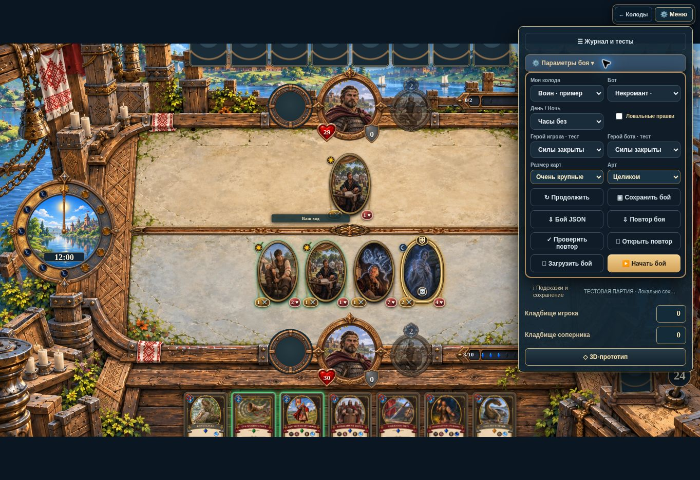

# MW — третий этап: стабильное представление и общие команды

Дата: 16.11.2026. Статус: объём третьего рабочего этапа реализован и проверен локально. Полная поставка всех анимаций ТЗ и финальная приёмка AN-15 ещё не завершены.

## Установка предыдущего патча

Перед началом проверены чистота checkout, история и обратная применимость MW_T03_Increment1_2026-11-16.patch. Он уже установлен коммитом efda3eaaedb0fc0120de60682ae421cc94009af8 поверх 1b88856d94817d394ab33ededfddb2dea4995124. Повторное применение не выполнялось, чтобы не задублировать изменения. Это установка в рабочую копию; публикация на GitHub/Pages — отдельное действие, в этом этапе не выполнялась.

## Что изменилось

| Область | Результат | Файлы |
|---|---|---|
| Экземпляры карт | Ряды и рука согласуются по owner/zone/UID; прежние DOM-корни, изображения renderer и неизменившиеся дочерние элементы остаются прикреплёнными | battle-dom-reconcile.js, deckgame.js |
| Все команды игрока | Розыгрыш любого поддержанного ядром типа карты, целевой розыгрыш, атака существом/героем, сила, окончание хода и подтверждение муллигана проходят через session/queue | deckgame.js |
| Причина перед итогом | attackDeclared, heroPowerDeclared и turnEnding предшествуют stateCommitted; цель атаки адресована экземпляром/героем | battle-presentation.js |
| ИИ | Существующий iterator принимает необязательный dispatcher; очередь завершается перед следующим шагом. Сортировки, RNG и стратегические условия не изменены | battle-engine.js, deckgame.js |
| Повтор ИИ | Стратегический ход записывается одной операцией runBotTurn; отдельные команды кадров не записываются вторично | battle-replay.js |
| 3D | Использует отдельный стабильный снимок для render/bridge, который не обновляется до commit; атака передаётся существующей animateAttack без повторного запуска из bridge | deckgame.js |
| Выбор | Сохраняются UID, requestId, cardId и частичный draft; загрузка проверяет наличие карты/вариантов на копии состояния и восстанавливает окно | battle-presentation.js, deckgame.js |
| Прерывание ИИ | Save посреди хода содержит актуальное игровое состояние без незавершённого агрегированного replay; после загрузки начинается новый replay checkpoint | deckgame.js |
| Дублирующий reveal | Старый отдельный показ заклинания после последствий отключён при активном общем presentation-модуле | battle-card-renderer-v2.1C.js |

Формат игрового сохранения остаётся v2. Необязательный presentationUI — дополнительное поле верхнего уровня: старые файлы без него загружаются по прежнему пути. Полный игровой snapshot остаётся приватным локальным сохранением; публичная проекция по-прежнему скрывает руки/порядок колод соперника. Дополнительные данные выбора не помещаются в публичный event stream.

Окно выбора не является уже оплаченной приостановленной командой: до полного подтверждения ядро не списывает ресурс. После принятия исход фиксируется и анимация не вызывает вторую оплату. Устаревший UID/неподдержанная версия sidecar не исполняются; посторонние варианты фильтруются, затем окончательную допустимость проверяет ядро.

Боевые эффекты, характеристики, цены, карточные тексты и правила времени не менялись. В battle-engine.js изменён только способ вызова уже существующих функций внутри botTurnFrames; без dispatcher синхронный runBotTurn работает как прежде.

## Проверки

- Полный Node-набор: **207/207 PASS**, без пропусков.
- 5 новых проверок presentation: адресация атаки/одно продвижение времени; эквивалентность ИИ; восстановление choice draft; отказ неполного выбора без оплаты; checkpoint внутри хода ИИ.
- Проверка ИИ включает 18 сочетаний seed/класса: queued-результат совпал с исходным runBotTurn, экспортированные повторы прошли verify. Это контрольная выборка, не доказательство корректности всех карт и всех RNG-сценариев.
- 3 DOM-проверки на минимальном порте DOM: перестановка/вставка сохраняют корни и image; меняется только изменившийся базовый дочерний элемент; дубликат ключа отвергается до изменения зоны. Разбор реального HTML проверен в Chrome.
- Прежняя проверка фиксированной паузы ИИ обновлена: теперь требуется await presentationDone вместо 1350мс. Функциональная эквивалентность дополнительно проверяется отдельным тестом, а не только строкой исходника.
- Pages build: 578 runtime-файлов; 377 проверок HTML/CSS/manifest PASS. git diff --check PASS.

Chrome, локальная сборка:

1. Продолжена тестовая партия второго этапа. Завершение хода передало инициативу ИИ и вернуло её игроку; время 21→22→23, затем 23→00→01.
2. Атака KNZ-002 в героя: во время сцены busy=true; после — HP противника30→29, управление доступно.
3. До и после передачи хода старые экземпляры сохранили DOM serial: minion u14=1, u17=2; старые карты руки также сохранили serial3–8, новая получила новый serial10.
4. Штатными тестовыми командами выданы NEU-001, мана10 и час12. Выбран ZAV-004, страница перезагружена, партия продолжена. Те же три предложения и выбранная отметка восстановлены; до подтверждения мана10/10. После подтверждения —3/10, один NEU-001 и один ZAV-004 на поле, диалог закрыт, ghost0, busy снят.
5. Для контрольной партии применялись тестовые команды, её результат не относится к кампании. Каталог не изменён.

Во время проверки обнаружена проблема управления старой боковой панелью: клики по частично перекрытым элементам не всегда достигают цели; закрытие панели с клавиатуры позволило продолжить. Исправление общей компоновки/перекрытий остаётся задачей этапа руки/UI; не объявлено исправленным этим патчем.

## Что не закрыто

Детальные события damage/armor/HP/overkill и фактические simultaneous-группы всё ещё требуют инструментализации точек ядра. Нельзя заменять их выдуманными промежуточными результатами или текстовыми логами. Нормализация фактического урона героя и итог после цепочки из T01 не исправлялись.

Движения временные: card lift/reveal и атака демонстрируют очередь, но не являются финальной motion-приёмкой. Непрерывное превращение карты в овал, позиционная вставка, FLIP соседей, полный добор/муллиган, таймер и часовые накопительные точки — впереди. Видимый овал и прямоугольный hitbox не перерабатывались.

Живая 3D-партия, mobile/touch, все браузеры, FPS, полный BF-12 и Q01–Q15 не принимались. Сохранение выбора реализовано для существующего pre-payment choice диалога; посреди оплаченной цепочки новое обязательное окно не вводилось.

## Оставшиеся этапы

Нумерация ниже — рабочие этапы общения; Txx — устойчивые задачи исходного ТЗ. Не смешивать «этап3» с полной приёмкой T03.

| Этап | Объём | Статус |
|---|---|---|
| 1 | T01 аудит | Завершён |
| 2 | T03 первый контракт и простой розыгрыш | Установлен efda3ea |
| 3 | Стабильные корни, общие команды/ИИ, восстановление выбора | Реализован локально; этот отчёт |
| 4 | T04 motion-прототип полного хода, общий темп и параметры | Следующий |
| 5 | T05–T09 рука, захват/отмена, добор, старт, непрерывный переход, вставка и перестроение | Осталось |
| 6 | T10–T13 атаки, фактический урон/защита, цепочки/гибель, сила и оружие | Осталось; техническая очередь подготовлена |
| 7 | T14–T17 этапы хода/таймер, часы, финальная подача ИИ, переполнение/усталость | Осталось; ИИ уже подключён к очереди |
| 8 | T18–T20 ресурсы VFX, адаптивность, reduced motion, устойчивость | Осталось; базовые отмена/timeout есть |
| 9 | T21–T24 вертикальный срез, регрессия, устройства/браузеры, финальная приёмка/передача | Осталось |

T02 сопровождает работу: D01 часы слева, D02 готовый овал и AN-10 фактический урон зафиксированы; у D03 уточнить старт/сброс/восстановление накопительных точек. Темп/стиль и минимальные устройства D04/D05 требуют приёмки. Пока это не блокирует следующий motion-прототип на временных параметрах.

## Передача в новый чат

Начинать с WORK_CONTEXT.md, затем этого отчёта, TASK_JOURNAL.md и постоянного Google-журнала MW-LOG-024. Пакет содержит отдельный патч этапа3 поверх efda3ea и накопительный mbox двух этапов поверх 1b88856. Уже установленный патч не применять повторно. На чужой рабочей копии сначала проверить HEAD и отсутствие собственных незакоммиченных изменений. Локальный commit не означает публикацию.
