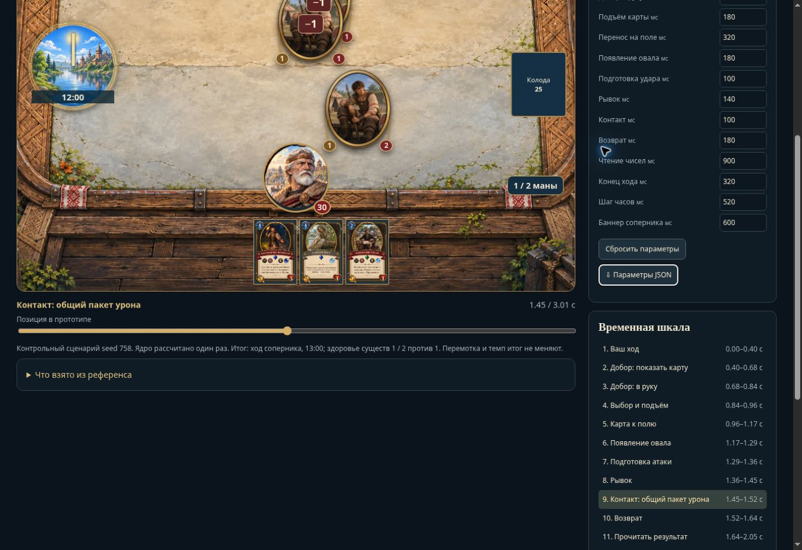

# MW — этап4 / T04: прототип полного хода

16.11.2026. Baseline: f875435c36bf067c5faf85c96a488683260d1c1b. Статус: прототип реализован и технически проверен; визуальное утверждение темпа/оформления D04 остаётся за пользователем.

## Что можно посмотреть

Открыть `battle-motion-lab.html` в собранной локальной версии. В меню тестового боя добавлена ссылка «▶ Motion-прототип». Экран отдельный: он не запускает deckgame, не пишет сохранение текущего боя и не меняет пользовательскую коллекцию/колоды.

Сценарий: начало своего второго хода → обычный добор → подъём выбранной карты → перенос на поле → существующий овальный портрет → подготовка атаки → рывок → общий контакт и два числа → возврат → чтение результата → завершение → +1 час → ход соперника.

Доступны воспроизведение/пауза, предыдущая/следующая сцена, возврат в начало, ползунок перемотки, выбор темпа0,75/1/1,5,14 настраиваемых длительностей, уменьшенное движение, выразительные числа или спокойные плашки, экспорт предложения в JSON. Изменение параметра сразу перестраивает шкалу, сохраняя текущую сцену и её относительную позицию.

Все длительности и визуальные варианты имеют статус **ПРЕДЛОЖЕНИЕ АГЕНТА**. Подготовка экрана не утверждает их автоматически. Настройки лаборатории не переключают текущий реальный бой на предложенные длительности.

## Общая конфигурация и файлы

`battle-motion-config.js` содержит нормализацию, длительности, пересчёт шкалы и чистый sampler. Этот же модуль подключён в основной бой: его прежние playerPlay260/attack320/opponentReveal700/heroPower260мс сохранены как defaults. Изменения стоимости, характеристик и правил отсутствуют.

`battle-motion-scenario.js` считает контрольный ход существующим ядром. `battle-motion-lab.html/.css/.js` — отдельный экран и player. `tests/battle_motion_lab.test.cjs` — функциональные проверки. В `docs/qa/MW_Stage4_Exported_Proposal.json` лежит действительно скачанный из браузера контрольный экспорт после проверки настройки900мс, а не вручную подставленный образец.

## Временная шкала по умолчанию

| Сцена | Параметр | Длительность, мс | От начала, с |
|---|---|---:|---|
| Ваш ход | turnBanner | 600 | 0,00–0,60 |
| Добор: показать | drawReveal | 420 | 0,60–1,02 |
| Добор: в руку | drawTravel | 240 | 1,02–1,26 |
| Выбор и подъём | playLift | 180 | 1,26–1,44 |
| Карта к полю | playTravel | 320 | 1,44–1,76 |
| Появление овала | summon | 180 | 1,76–1,94 |
| Подготовка атаки | attackPrepare | 100 | 1,94–2,04 |
| Рывок | attackLunge | 140 | 2,04–2,18 |
| Контакт | contact | 100 | 2,18–2,28 |
| Возврат | attackReturn | 180 | 2,28–2,46 |
| Прочитать результат | numbers | 620 | 2,46–3,08 |
| Завершение | endBanner | 320 | 3,08–3,40 |
| Один час | hourStep | 520 | 3,40–3,92 |
| Ход соперника | opponentBanner | 600 | 3,92–4,52 |

4,52с — логическая длительность предлагаемой шкалы, не замер референса и не обещание производительности устройства. Для этого контрольного прототипа сцены собраны последовательно; окончательная оркестрация может перекрывать независимый декор по AN-01. Reduced motion убирает траектории и сокращает акценты; при текущих defaults остаётся0,80с. Частота кадров не измерялась.

## Сценарий и неизменность правил

Используются обе утверждённые примерные колоды Воин по30 карт, фиксированный seed758 и стандартные makeGame/confirmMulligan/playCard/endTurn/attack. Подготовка честно разыгрывает KNZ-002 с обеих сторон в первом круге; затем записывается один полный ход игрока. Ручной установки маны, атаки, здоровья, готовности или порядка колод нет.

Зафиксирован текущий режим демо timeMode=off, как в основной тестовой сборке. Это не утверждение отсутствия штрафов в правилах. Сценарий не проверяет реализацию всех временных штрафов.

После настройки сцены рассчитаны заранее. Play, pause, seek, изменение темпа и повторный просмотр читают снимки; они не вызывают боевые команды, RNG или оплату. После перемотки итог остаётся тем же: очередность переходит сопернику, час13:00, у игрока существа с1 и2HP, у соперника1HP, текущая мана игрока1. Мана/HP на промежуточных кадрах берутся из подтверждённых снимков; player не объявлен универсальным представлением всех цепочек.

Для контакта используются две amount=1 из событий ядра в специально ограниченном обмене двух KNZ-002 без аур, брони, щитов, лечения и overkill. Оба числа появляются в одной сцене. Здесь известны два единственных участника; это не новый общий damage adapter. Если карта/колода больше не позволяет воспроизвести зафиксированный сценарий, либо числа/участники изменились, лаборатория останавливается с ошибкой и требует пересмотра fixture. Она не подменяет параметры карт и не выдумывает эффект.

## Референсы и решения

[ТЗ с раскадровками](https://docs.google.com/document/d/11IrO-VbDSetrU8EwKcoDpslu2O4b-3Kj/edit): R02 00:44–00:49 — объявление/добор; R03 01:03–01:11 — фокус карты; R05 01:58–02:00 — перенос; R09 03:05–03:06 — атака/контакт. Таймкоды видны и в самом экране. Арт Hearthstone в runtime не добавлен: используются существующие ресурсы MW и v05-renderer.

D02: готовый овал переиспользован, новая форма/новый карточный арт не рисовались. D03: часы слева и один шаг указателя показаны; накопление точек уже утверждено, но начальное число/сброс/восстановление ещё требуют решения. Лаборатория не вводит альтернативную норму точек.

## Проверки и найденное исправление

- **214/214 Node PASS**,0fail/0skip;7 новых проверок: воспроизводимость легального fixture/неизменность каталога; обычный добор/пакет урона; seeking/speed/reduced без нового расчёта; интервалы и граничные позиции; неверные/нулевые параметры; приватность публичных снимков; остановка при изменённой карте.
- Build583 runtime-файла;381 проверка ссылок/manifest PASS;git diff --check PASS.
- Chrome: обычное воспроизведение запущено и дошло до розыгрыша; затем настройки были изменены. Полное воспроизведение reduced-motion дошло до «Ход соперника»,0,80/0,80с,13:00,HP1/2 против1. Полную длительность обычного проигрывания секундомером не измеряли.
- Изменены темп1,5,плашки иnumbers900; переход к контакту показал два−1, счётчик построения сценария остался1. Это диагностический счётчик сборки fixture в экземпляре player, не счётчик отдельных боевых команд подготовки.
- При проверке скачанного JSON первоначально обнаружено, что number input визуально показывает900, но onchange не успел применить его и экспорт содержал620. Исправлено на применение при input. После reload повторно скачан и прочитан JSON: numbers900,speed1,5,reduced=false,badge,14scenes,конец шкалы3200мс,hour13. Контрольный экспорт сохранён рядом со снимком.
- Закреплён проверенный seed758: fixture создаётся без перебора. Финальная версия после исправления input повторно загружена в Chrome, настройки/экспорт сверены, весь Node-набор повторён. Полное reduced-воспроизведение проверялось на предыдущем варианте с тем же seed и теми же снимками.

## Границы поставки

Это один контролируемый полный ход для сравнения motion; не вся AN/Q-приёмка и не финальный production pipeline добора/вставки/массовой гибели. Проблемы overkill/checkEnd из T01, hitbox, боевой таймер, полная событийная детализация и накопительные точки не исправлены этим этапом. Не заявляются FPS, mobile/touch и полная3D-сессия. Утверждение стиля и темпа D04, а также целевых устройств D05 остаётся открытым.

Публичные GitHub main/Pages этой работой не обновлялись. Запускать после установки патча в свою рабочую копию и сборки: `python tools/build_pages.py`, затем `python -m http.server 8000 --directory _site`, открыть `http://localhost:8000/battle-motion-lab.html`. Проверять установочную инструкцию пакета и свой HEAD; не накатывать накопительный патч поверх уже установленных этапов.

## Оставшиеся этапы

5 — T05–T09: рука/hover, захват/отмена, добор/старт, непрерывный переход, позиционная вставка и перестроение.
6 — T10–T13: окончательная атака, фактический урон/защита, цепочки/гибель, сила и оружие.
7 — T14–T17: конец/начало хода, таймер, часы, окончательная подача ИИ, переполнение/усталость.
8 — T18–T20: ресурсыVFX, адаптивность, reduced-motion и восстановление во всех сценах.
9 — T21–T24: интеграция, регрессия, устройства/браузеры и финальная приёмка/передача.

Прототип этапа4 готов для оценки; его параметры не считать автоматически принятыми при переходе к этапу5. Продолжать с WORK_CONTEXT.md, этим отчётом, TASK_JOURNAL.md и постоянным журналом MW-LOG-026.
